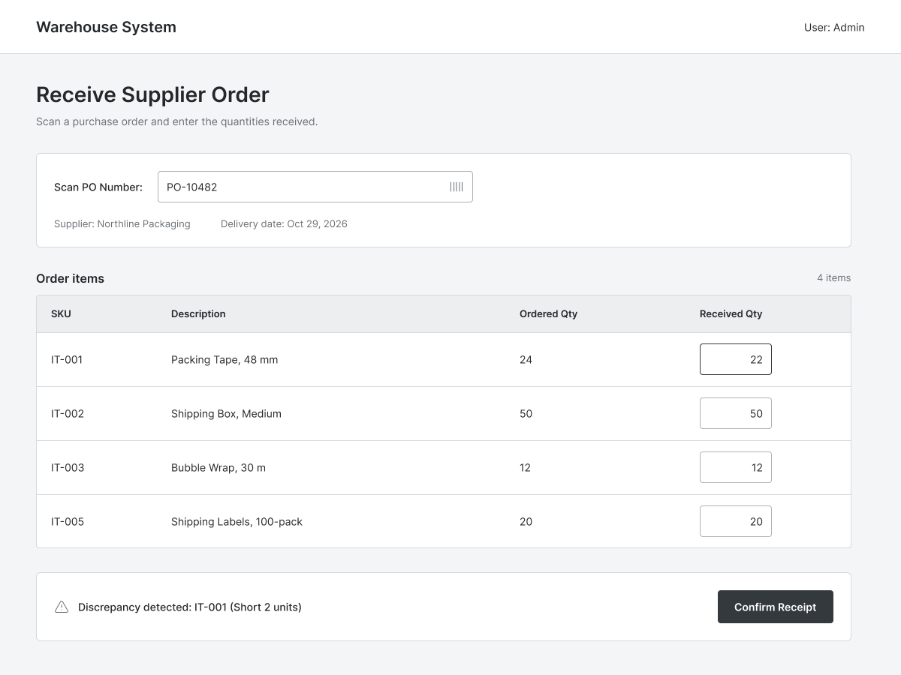

# Feature: Receive Supplier Orders

**Feature ID:** 11
**Branch pattern:** `feature/11-receive-supplier-orders`
**Status:** Draft
**Created:** 2026-10-13
**Input:** Record supplier deliveries, identify the purchase order and receiving worker, and compare received quantities with ordered quantities.

## User Stories

### US-11.1: Start receiving a supplier shipment
**As a** warehouse worker
**I want to** identify the supplier order using its PO number
**So that** receive the correct shipment

**Priority:** P1
**Independent test:** Verify that the system supports the ability to identify the supplier order using its PO number.
**Acceptance scenarios:** see US-11.1 under Gherkin AC

### US-11.2: Record received items
**As a** warehouse worker
**I want to** scan or identify each received item and enter its quantity
**So that** record what actually arrived

**Priority:** P1
**Independent test:** Verify that the system supports the ability to scan or identify each received item and enter its quantity.
**Acceptance scenarios:** see US-11.2 under Gherkin AC

### US-11.3: Record receiving responsibility and location
**As a** warehouse worker
**I want to** record the receiving worker and receiving door or station
**So that** trace where and by whom the shipment was received

**Priority:** P1
**Independent test:** Verify that the system supports the ability to record the receiving worker and receiving door or station.
**Acceptance scenarios:** see US-11.3 under Gherkin AC

### US-11.4: Review quantity discrepancies
**As a** warehouse worker or supervisor
**I want to** compare quantities received with quantities ordered
**So that** identify shortages or overages for reconciliation

**Priority:** P1
**Independent test:** Verify that the system supports the ability to compare quantities received with quantities ordered.
**Acceptance scenarios:** see US-11.4 under Gherkin AC

## Functional Requirements

- **FR-001**: The system MUST allow a worker to identify the supplier order by its PO number.
- **FR-002**: The system MUST show the matched supplier order and its expected items after a valid PO number is entered.
- **FR-003**: The system MUST allow a worker to identify each received item by scanning its barcode or entering its product code.
- **FR-004**: The system MUST record the quantity received for each supplier-order line.
- **FR-005**: The system MUST record the receiving employee and receiving door or station when those details are captured.
- **FR-006**: The system MUST compare quantity received with quantity ordered and identify a difference.
- **FR-007**: The system MUST retain the recorded receiving quantities and discrepancy information for later review.
- **FR-008**: The system MUST support receiving information from the Bill of Lading, including delivery date and shipment details when available.
- **FR-009**: [NEEDS CLARIFICATION: Confirm how partial deliveries, overages, damaged goods, and discrepancy approvals change order status.]

## Assumptions

- Scanning hardware (barcode scanners) inputs behave like standard keyboard inputs.
- A single PO can be received in multiple partial shipments.
- The receiving door is a predefined location in the Warehouse system.

## Edge Cases

- Worker enters a PO number that is already fully received.
- Worker scans an item that does not belong to the PO.
- Worker enters a received quantity significantly higher than ordered (overage).
- System goes offline mid-receiving (handling pending sync).

## Success Criteria

- PO status updates dynamically as items are received (e.g., Partially Received).
- Discrepancies are clearly flagged and stored.
- The receiving employee and location are accurately logged for auditing.

## Key Entities

- **Supplier Order**: the purchase order being received.
- **Supplier Order Line**: ordered item and quantity.
- **Receiving Record**: details about a supplier delivery and actual quantities received.
- **Bill of Lading**: shipment document identifying shipped items and quantities.
- **Employee**: worker who receives the shipment.

## Initial Data Model

- Receiving Record: receiving_id, supplier_order_id, PO_number, receiving_date, receiving_employee_id, receiving_door, bill_of_lading_reference.
- Receiving Line: receiving_line_id, receiving_id, supplier_order_line_id, item_id, quantity_received, discrepancy_status.

## Gherkin AC

### US-11.1 — Start receiving a supplier shipment

#### Scenario: PO identifies the expected order
* **Given** a supplier order exists with a PO number
* **When** the worker enters or scans the PO number
* **Then** the system displays the matching order and its expected items

### US-11.2 — Record received items

#### Scenario: Received quantity is recorded
* **Given** the correct supplier order is open for receiving
* **When** the worker scans an item and enters the received quantity
* **Then** the system records the quantity against the matching order line

### US-11.3 — Record receiving responsibility and location

#### Scenario: Quantity difference is detected
* **Given** an order line has an ordered quantity
* **When** the worker records a different received quantity
* **Then** the system identifies the shortage or overage for review

### US-11.4 — Review quantity discrepancies

#### Scenario: Receiving worker and door are captured
* **Given** a worker is processing a supplier delivery
* **When** the worker selects or scans their identifier and receiving door
* **Then** the system associates the receiving record with that worker and door

## Data Ownership

- **Receiving Record** and **Receiving Line** are owned by warehouse operations.
- Warehouse workers have write access to receiving quantities.
- Inventory balances are updated by this feature (or trigger a downstream event for put-away).

## API Requirements

- `GET /supplier-orders/po/{po_number}` — find order by PO.
- `POST /receiving-records` — start a receiving session.
- `POST /receiving-records/{id}/lines` — add received item lines.
- `PUT /receiving-records/{id}/finalize` — finalize the receipt.

## Screen Requirements

- **Receiving Screen**: PO entry field.
- **Receiving Grid**: Expected Item, Expected Qty, [Input] Received Qty, Discrepancy indicator.
- Fields to select Receiving Door and verify Worker ID.

## Definition of Done

- All functional requirements implemented and demonstrated.
- Discrepancy logic works correctly.
- Screen is optimized for fast data entry (keyboard/scanner friendly).
- Screen reviewed against UI mockups.

## Out of Scope

- Automated quality control/inspection steps.
- Direct integration with carrier tracking APIs.