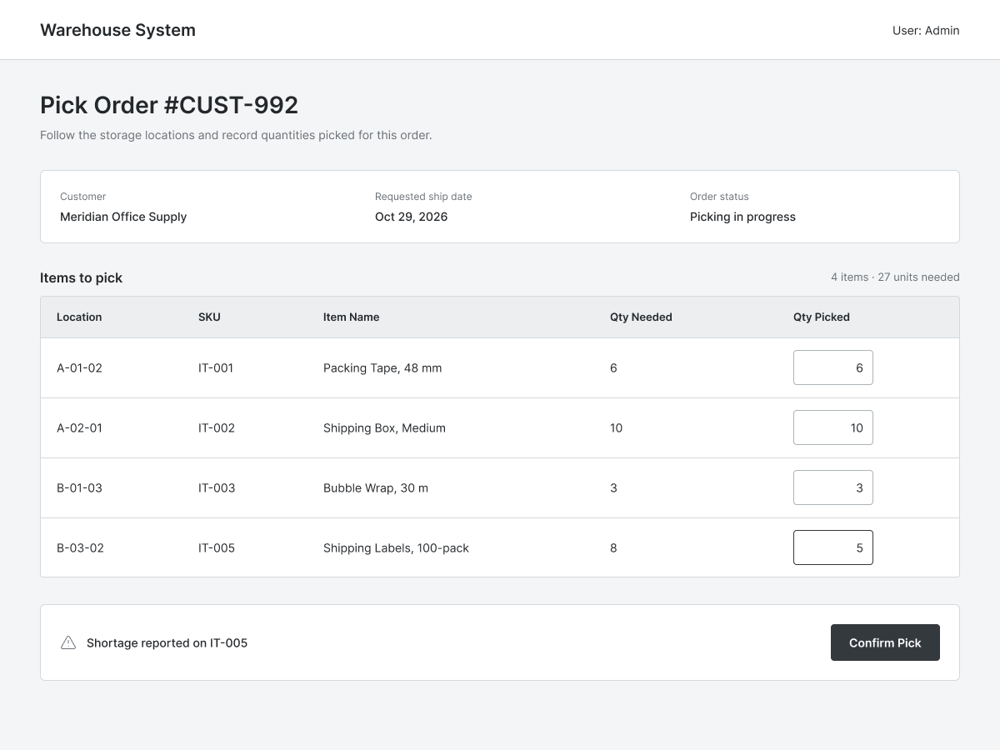

# Feature: Pick Customer Orders

**Feature ID:** 14
**Branch pattern:** `feature/14-pick-customer-orders`
**Status:** Draft
**Created:** 2026-10-13
**Input:** Guide warehouse workers through picking the right item, from the right location, in the required quantity.

## User Stories

### US-14.1: View picking instructions
**As a** warehouse worker
**I want to** view the customer order's items, quantities, and picking locations
**So that** pick orders efficiently

**Priority:** P1
**Independent test:** Verify that the system supports the ability to view the customer order's items, quantities, and picking locations.
**Acceptance scenarios:** see US-14.1 under Gherkin AC

### US-14.2: Verify the item being picked
**As a** warehouse worker
**I want to** scan or otherwise verify an item before picking it
**So that** avoid picking the wrong product

**Priority:** P1
**Independent test:** Verify that the system supports the ability to scan or otherwise verify an item before picking it.
**Acceptance scenarios:** see US-14.2 under Gherkin AC

### US-14.3: Record actual picked quantity
**As a** warehouse worker
**I want to** record how many units were picked
**So that** report what can actually be shipped

**Priority:** P1
**Independent test:** Verify that the system supports the ability to record how many units were picked.
**Acceptance scenarios:** see US-14.3 under Gherkin AC

### US-14.4: Record a picking shortage
**As a** warehouse worker
**I want to** record when a location does not contain enough stock
**So that** make the shortage visible before shipment

**Priority:** P1
**Independent test:** Verify that the system supports the ability to record when a location does not contain enough stock.
**Acceptance scenarios:** see US-14.4 under Gherkin AC

## Functional Requirements

- **FR-001**: The system MUST show the items and quantities to pick for a customer order.
- **FR-002**: The system MUST show the primary picking location for an item when a location is assigned.
- **FR-003**: The system MUST support a picking sequence for the order or route when sequence information is available.
- **FR-004**: The system MUST allow the worker to verify the picked item using a barcode or item code.
- **FR-005**: The system MUST record the actual quantity picked for each order line.
- **FR-006**: The system MUST allow a worker to record a shortage when the available quantity is less than the requested quantity.
- **FR-007**: The system MUST retain both the ordered quantity and the actual picked quantity.
- **FR-008**: The system MUST update or reserve inventory according to the configured picking process.
- **FR-009**: [NEEDS CLARIFICATION: Confirm whether inventory is decremented at pick confirmation or at shipment.]

## Assumptions

- Picking is done via a mobile device or handheld scanner.
- The system guides the user to a specific location (e.g., "Aisle 4, Bin B").
- If an item is short, the system allows partial picking so the rest of the order can proceed.

## Edge Cases

- Worker scans the wrong barcode at a location.
- Worker finds fewer items at the location than the system says should be there (inventory inaccuracy).
- Picking sequence requires jumping between aisles.
- Inventory is decremented at pick time, but the order is canceled before shipment.

## Success Criteria

- Pickers can complete tasks without paper.
- Scanning enforces picking the correct item.
- Picked quantities accurately reflect what will be shipped.
- Shortages are captured for reporting.

## Key Entities

- **Customer Order**: order being picked.
- **Customer Order Line**: ordered and picked quantities.
- **Inventory Balance**: stock available at a location.
- **Inventory Location**: location from which an item is picked.
- **Employee**: picker.

## Initial Data Model

- Customer Order Line: item_id, quantity_ordered, quantity_picked, shortage_quantity or shortage status.
- Pick Activity: pick_activity_id, customer_order_id, item_id, location_id, quantity_picked, employee_id, picked_at.

## Gherkin AC

### US-14.1 — View picking instructions

#### Scenario: Picker sees picking instructions
* **Given** a customer order is ready for picking and its items have locations
* **When** the warehouse worker opens the order
* **Then** the system displays each item, requested quantity, and available picking location

### US-14.2 — Verify the item being picked

#### Scenario: Wrong item is scanned
* **Given** the picker is working on an order line for a specific item
* **When** the picker scans a different item
* **Then** the system identifies that the scanned item does not match the expected item

### US-14.3 — Record actual picked quantity

#### Scenario: Shortage is recorded
* **Given** the requested quantity exceeds stock available at the picking location
* **When** the picker records the actual quantity picked
* **Then** the system saves the picked quantity and identifies the shortage

### US-14.4 — Record a picking shortage

#### Scenario: Correct quantity is picked
* **Given** the picker has the correct item and sufficient stock
* **When** the picker verifies the item and enters the picked quantity
* **Then** the system records the actual quantity picked for that order line

## Data Ownership

- **Pick Activity** is owned by warehouse operations.
- **Inventory Balance** is updated (decremented) by picking.
- **Customer Order Line** (picked quantities) is updated by picking.

## API Requirements

- `GET /picking/worklist` — get orders ready to be picked.
- `GET /picking/orders/{id}` — get picking details for a specific order.
- `POST /picking/activities` — record a pick (item, location, qty).
- JSON bodies; server-side validation of scanned barcodes vs. expected item.

## Screen Requirements

- **Picking Worklist**: list of unfulfilled orders.
- **Picking Execution Screen**: Item Name, Location Code (large text), Requested Qty.
- Scan input field. If scan matches, allow Qty entry. If short, allow "Short" button.

## Definition of Done

- All functional requirements implemented and demonstrated.
- Barcode validation successfully rejects wrong scans.
- Inventory updates perfectly aligned with picked quantities.
- Screen reviewed against UI mockups.

## Out of Scope

- Automated picking robotics (AS/RS).
- Voice-directed picking.