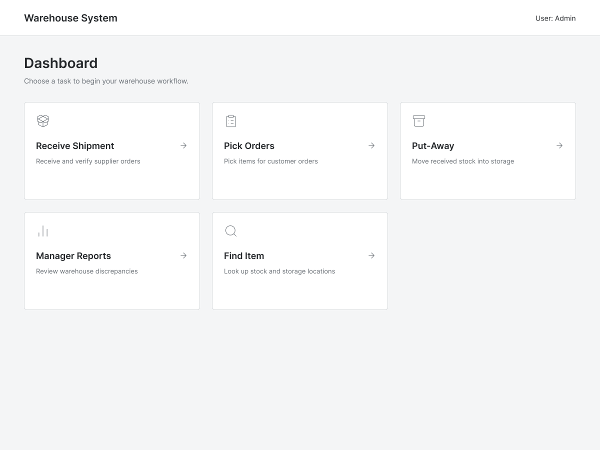

# Feature: Find Items and Warehouse Locations

**Feature ID:** 17
**Branch pattern:** `feature/17-find-items-and-locations`
**Status:** Draft
**Created:** 2026-10-13
**Input:** Help warehouse workers find items and available storage locations during daily warehouse operations.

## User Stories

### US-17.1: Find an item
**As a** warehouse worker
**I want to** search for an item by SKU, UPC, or description
**So that** locate stock without searching the warehouse manually

**Priority:** P1
**Independent test:** Verify that the system supports the ability to search for an item by SKU, UPC, or description.
**Acceptance scenarios:** see US-17.1 under Gherkin AC

### US-17.2: Find an item's location
**As a** warehouse worker
**I want to** view the warehouse and location where an item is stored
**So that** go to the correct storage slot

**Priority:** P1
**Independent test:** Verify that the system supports the ability to view the warehouse and location where an item is stored.
**Acceptance scenarios:** see US-17.2 under Gherkin AC

### US-17.3: Find an empty storage location
**As a** warehouse worker
**I want to** identify an available storage slot
**So that** put stock away without guessing

**Priority:** P1
**Independent test:** Verify that the system supports the ability to identify an available storage slot.
**Acceptance scenarios:** see US-17.3 under Gherkin AC

## Functional Requirements

- **FR-001**: The system MUST allow a worker to search for an item by SKU, UPC when available, or description.
- **FR-002**: The system MUST show known inventory quantities and locations for a matching item.
- **FR-003**: The system MUST distinguish primary picking, reserve, and receiving locations when location types are configured.
- **FR-004**: The system SHOULD identify available storage locations for put-away.
- **FR-005**: The system MUST NOT report a location as empty when it has a positive recorded inventory quantity.

## Assumptions

- Search should be fast and case-insensitive.
- A single item can be stored in multiple locations across the warehouse.
- "Available storage location" means a location with zero recorded inventory or a capacity that is not yet full (if capacity tracking is enabled).

## Edge Cases

- Partial search terms match multiple items (requires a list of results).
- An item exists in the catalog but has zero inventory in all locations.
- A location is marked as "empty" in the system, but a worker physically finds stock there (system mismatch).
- Searching by a barcode that doesn't exist.

## Success Criteria

- Workers can find items quickly without leaving their mobile device.
- Location information is accurate and reflects real-time inventory balances.
- The system clearly communicates when no item matches the search term.

## Key Entities

- **Item**: product being searched for.
- **Inventory Balance**: quantity stored at a location.
- **Inventory Location**: warehouse slot or storage area.

## Initial Data Model

- Item: item_id, description, SKU, UPC.
- Inventory Balance: item_id, location_id, quantity_on_hand.
- Inventory Location: location_id, warehouse_id, location_code, location_type, capacity if tracked.

## Gherkin AC

### US-17.1 — Find an item

#### Scenario: Item is found by SKU
* **Given** an item with a known SKU exists
* **When** the worker searches using that SKU
* **Then** the system displays the matching item and its known locations

### US-17.2 — Find an item's location

#### Scenario: Empty location is found
* **Given** a warehouse has locations with recorded quantities
* **When** the worker asks to find an available location
* **Then** the system returns a location with zero recorded inventory and marks it as a candidate location

### US-17.3 — Find an empty storage location

#### Scenario: No matching item is found
* **Given** the search term does not match an item
* **When** the worker performs the search
* **Then** the system clearly reports that no matching item was found

## Data Ownership

- Read-only feature. Owned by warehouse operations.
- Reads from **Item**, **Inventory Balance**, and **Inventory Location** without modifying them.

## API Requirements

- `GET /search/items?q={query}` — search catalog items.
- `GET /search/locations?status=empty` — find empty locations.
- JSON responses optimized for mobile data transfer.

## Screen Requirements

- **Item Search screen**: Search bar (accepts text or scanner input).
- **Search Results**: List of items with descriptions and a quick summary of total on-hand quantity.
- **Item Detail**: Breakdown of quantities per location.
- **Find Empty Location**: Button to trigger search for available slots.

## Definition of Done

- All functional requirements implemented and demonstrated.
- Search returns results in under 1 second.
- No false positives for empty locations.
- Screen reviewed against UI mockups.

## Out of Scope

- Indoor GPS/map routing to the exact aisle.
- Predictive search (e.g., "people who searched for this also searched for...").