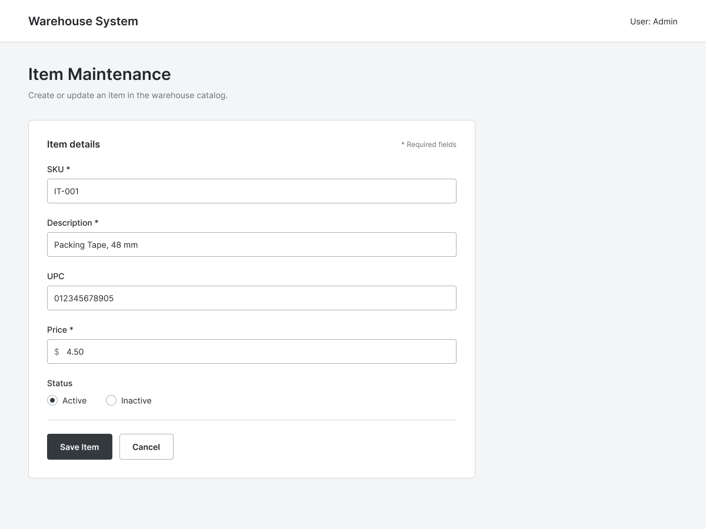

# Feature: Item Maintenance

**Feature ID:** 3
**Branch pattern:** `feature/3-item-maintenance`
**Status:** Draft
**Created:** 2026-10-13
**Input:** Maintain the catalog of products the warehouse buys, stores, and sells.

## User Stories

### US-3.1: Add an item
**As a** office employee
**I want to** add an item with its product details
**So that** make the product available for ordering and inventory tracking

**Priority:** P1
**Independent test:** Verify that the system supports the ability to add an item with its product details.
**Acceptance scenarios:** see US-3.1 under Gherkin AC

### US-3.2: Update an item
**As a** office employee
**I want to** update an item's details
**So that** keep product information current

**Priority:** P1
**Independent test:** Verify that the system supports the ability to update an item's details.
**Acceptance scenarios:** see US-3.2 under Gherkin AC

### US-3.3: Deactivate an item
**As a** office employee
**I want to** deactivate an item that is no longer sold
**So that** preserve historical order and inventory information

**Priority:** P1
**Independent test:** Verify that the system supports the ability to deactivate an item that is no longer sold.
**Acceptance scenarios:** see US-3.3 under Gherkin AC

## Functional Requirements

- **FR-001**: The system MUST allow an authorized office employee to add an item.
- **FR-002**: The system MUST allow an authorized office employee to update an item.
- **FR-003**: The system MUST allow an authorized office employee to deactivate an item.
- **FR-004**: The system MUST maintain an item description, SKU, UPC when available, and current selling price.
- **FR-005**: The system MUST identify each item with a stable system-generated identifier.
- **FR-006**: The system MUST prevent duplicate SKU values when SKU is used as a unique item code.
- **FR-007**: The system MUST preserve item records referenced by existing orders or inventory history.
- **FR-008**: The system MUST reject a non-positive selling price.

## Assumptions

- SKU is unique across all active items.
- UPC is optional because not all products carry one.
- The selling price is the current price used for new customer orders; historical prices are preserved on order lines.

## Edge Cases

- Duplicate SKU is entered.
- Selling price is zero or negative.
- An item is referenced by an open customer order or supplier order and is deactivated.
- UPC is entered in an inconsistent format.
- Two employees update the same item concurrently.

## Success Criteria

- An item can be created, updated, and retrieved.
- Duplicate SKUs are rejected with a clear message.
- Deactivation marks the item inactive without deleting history.
- Inactive items are not offered for new orders or replenishment.

## Key Entities

- **Item**: a product that the warehouse purchases, stores, and sells.
- **Supplier Item Price**: the price a particular supplier charges for a particular item.

## Initial Data Model

- Item: item_id, description, SKU, UPC, selling price, active status.
- Supplier Item Price: supplier_item_price_id, supplier_id, item_id, supplier cost, effective date if tracked.

## Gherkin AC

### US-3.1 — Add an item

#### Scenario: Item is added
* **Given** an authorized employee has a product's required details
* **When** the employee saves the item
* **Then** the system stores the item and makes it available to orders and inventory

### US-3.2 — Update an item

#### Scenario: Duplicate SKU is rejected
* **Given** an item already uses a particular SKU
* **When** the employee attempts to save a different item with that SKU
* **Then** the system reports the duplicate and does not create a second item with that SKU

### US-3.3 — Deactivate an item

#### Scenario: Referenced item is deactivated
* **Given** an item is referenced by an order or inventory record
* **When** the employee deactivates the item
* **Then** the system preserves the historical references and marks the item inactive

## Data Ownership

- **Item** is owned by the office/administrative function.
- **Supplier Item Price** is owned by the supplier-management function.
- Only authorized office employees may create, update, or deactivate items.
- Inventory, picking, and shipping features MAY read item data but MUST NOT modify item attributes.

## API Requirements

- `GET /items` — list items (filters: `active`, `sku`, `description`).
- `GET /items/{id}` — retrieve one item.
- `POST /items` — create an item.
- `PUT /items/{id}` — update an item.
- `PATCH /items/{id}/deactivate` — deactivate.
- JSON bodies; server-side uniqueness check on SKU.

## Screen Requirements

- **Item Maintenance screen**: list with search by SKU/UPC/description; Add/Edit form with description, SKU, UPC, selling price, active status; inline validation.
- Deactivate action with confirmation and reference check.

## Definition of Done

- All functional requirements implemented and demonstrated.
- Duplicate-SKU and deactivation scenarios pass their Gherkin AC.
- Inactive items excluded from new orders and replenishment.
- Screen reviewed against the UI mockups in `Warehouse/docs/`.

## Out of Scope

- Bulk item import.
- Item images or rich media.
- Price-history versioning beyond what order lines preserve.