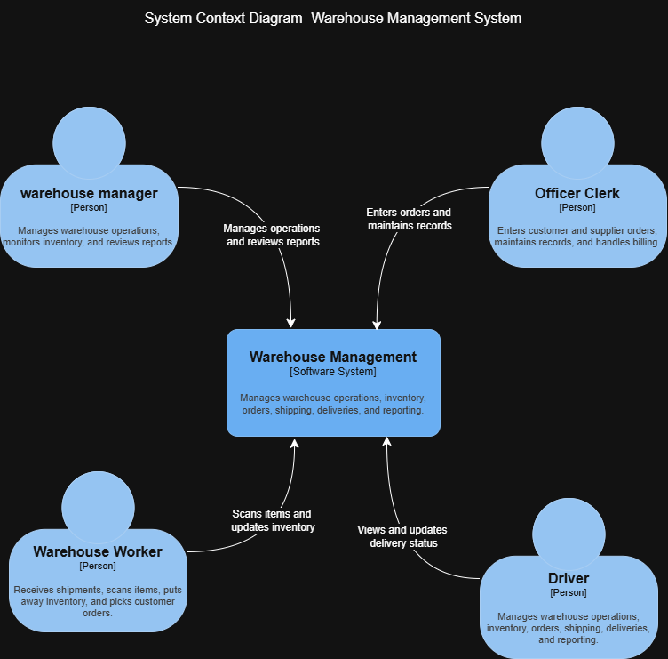
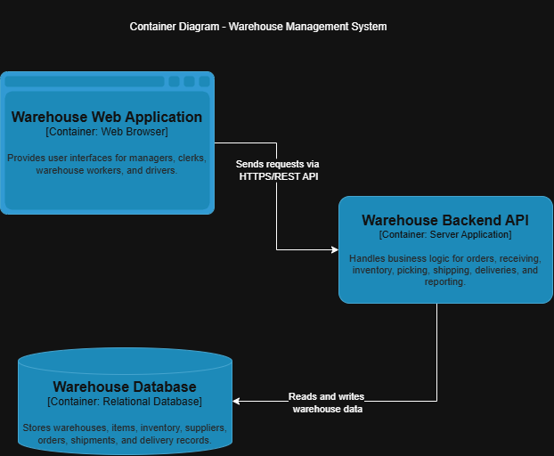
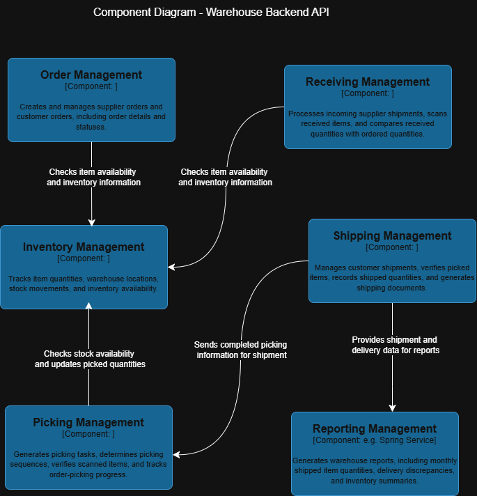

# C4 Architecture Diagrams

## Level 1: System Context Diagram

**Description:**
This System Context diagram defines the boundary of the Warehouse Management System and illustrates its relationships with the external users it serves. The system acts as a central hub for warehouse operations. There are four primary actors: the **Office Clerk**, who enters orders and maintains master records; the **Warehouse Manager**, who monitors operations and reviews reports; the **Warehouse Worker**, who interacts with the system to scan items, receive shipments, and pick orders; and the **Driver**, who views assignments and updates delivery statuses. This diagram establishes that the Warehouse Management System is the primary software solution responsible for handling all inventory, order, shipping, and delivery workflows for these distinct user roles.

---

## Level 2: Container Diagram

**Description:**
The Container diagram zooms into the Warehouse Management System to reveal its high-level technical architecture. The system is split into three main containers. First, the **Warehouse Web Application** serves as the frontend interface for all users (managers, clerks, workers, and drivers), communicating with the backend via HTTPS/REST API calls. Second, the **Warehouse Backend API** acts as the central server application, handling all business logic, routing, and validation for core operations like receiving, inventory management, and reporting. Finally, the **Warehouse Database** is a relational database that securely stores all persistent data, including warehouses, items, orders, shipments, and delivery records, which the Backend API reads from and writes to.

---

## Level 3: Component Diagram (Warehouse Backend API)

**Description:**
The Component diagram provides a detailed view inside the Warehouse Backend API, breaking down the monolithic backend into logical, feature-specific components that interact with one another. 
*   **Order Management** sits at the top, handling the creation of both supplier and customer orders while checking item availability against Inventory.
*   **Receiving Management** processes incoming supplier shipments and updates Inventory Management with newly arrived stock.
*   **Inventory Management** acts as the central source of truth for all stock quantities and locations, serving both Order Management and Picking Management.
*   **Picking Management** generates tasks, verifies scanned items, and updates inventory levels as items are picked for customer orders.
*   **Shipping Management** verifies picked items, generates shipping documents, and passes shipment data to both the database and the Reporting Management component.
*   Finally, **Reporting Management** aggregates data from Shipping, Delivery, and Inventory to generate necessary business reports (such as out-of-stock lists and delivery discrepancies) for warehouse managers.